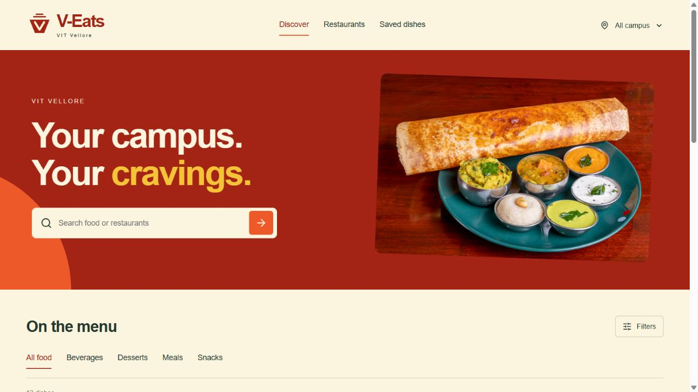
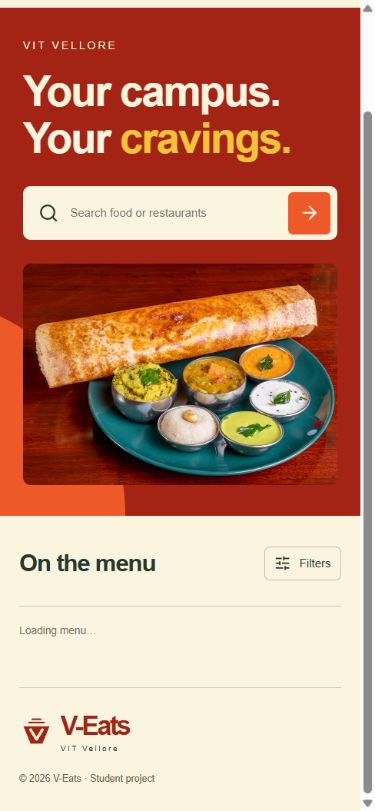
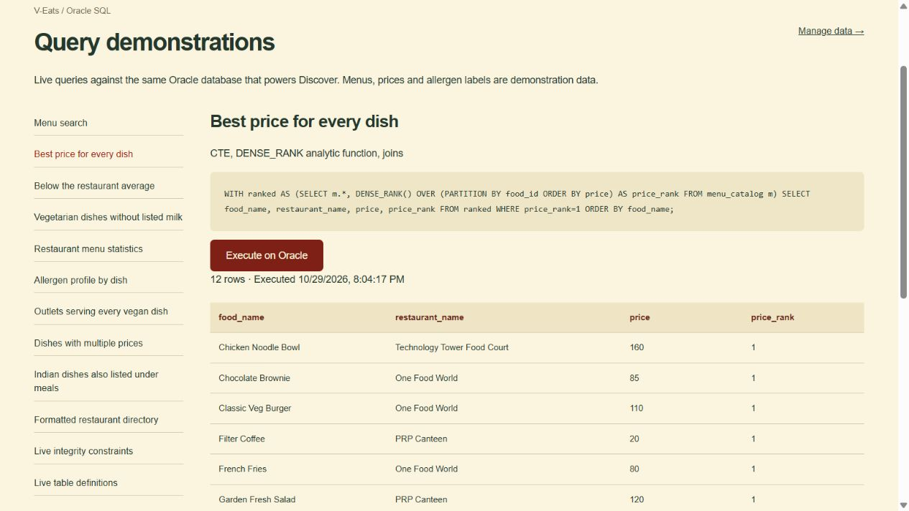

# V-Eats: Oracle SQL database and frontend connectivity

Group members: [add names and registration numbers]

Submission date: [add date]

## Project purpose

V-Eats is a VIT Vellore food-discovery database application. Students search food by cuisine, category, diet, campus location and listed allergens, inspect restaurant menus and compare sample prices. Administrators manage the same Oracle data through the frontend. The project demonstrates relational database integrity and SQL execution.

## Technology and connectivity

Next.js App Router, React and TypeScript supply the frontend and backend routes. The node-oracledb Thin driver connects through a pool to local Oracle Database Free, FREEPDB1, schema VEATS_APP. Each write uses bind parameters and explicit COMMIT; errors trigger ROLLBACK. Database credentials remain server-side in ignored .env.local. Management uses an eight-hour signed HTTP-only session cookie.

## ER-to-relational mapping

The entities are RESTAURANT, FOOD_ITEM, CATEGORY, CUISINE, DIETARY_TYPE and ALLERGEN. CONTAINS models the restaurant–food many-to-many relationship and stores price. HAS_ALLERGEN models the food–allergen many-to-many relationship. Each food references one category, cuisine and dietary type. The location composite attribute is flattened into BLOCK and LANDMARK. Restaurant MUST_HAVE is stored as a JSON string array; it is not an enforced reference to FOOD_ITEM. Human-readable lookup IDs currently equal lookup names.

The supplied handwritten relational list omits RESTAURANT_ID from CONTAINS and includes a redundant ALLERGEN_ID on FOOD_ITEM. This implementation follows the ER diagram and corrects those two inconsistencies. Optional photo, source and description fields extend the supplied schema. SQL foreign keys enforce references, with restrictive deletion. All required classification FKs are NOT NULL. Minimum participation (such as requiring every restaurant to have a menu) is not enforced: an administrator can create a parent before adding its children.

## Dataset and provenance

The database contains 5 outlets, 12 food items, 23 menu rows, 12 allergen links, 4 categories, 4 cuisines, 3 dietary types and 5 allergens. Outlet locations are based on public VIT documents. All menus, prices, dietary and allergen labels are academic sample data. Photos are illustrative. No verified current campus price list was retrieved.


## Requirements coverage


## Status against the supplied assignment screenshots

| Requirement | Implementation / evidence | Status |
| --- | --- | --- |
| Oracle SQL database | Oracle Database Free, FREEPDB1 PDB, VEATS_APP schema, local Docker storage | Implemented and connected |
| Database creation | Existing Oracle Free instance supplies CDB/PDB; setup creates isolated app schema; manual script 00-create-user.sql | Implemented schema setup; existing database reused |
| Table creation | Eight tables and MENU_CATALOG view in 01-schema.sql | Executed |
| Integrity constraints | PK, composite PK, FK, NOT NULL, UNIQUE, positive bounded price CHECK, JSON CHECK; live dictionary reports | Executed and tested |
| Data population | 5 outlets, 12 food items, 23 menus, 12 food-allergen links, 4 categories, 4 cuisines, 3 diets, 5 allergens | Executed |
| DDL statements | CREATE TABLE, ALTER TABLE, TRUNCATE, DROP, CREATE INDEX, CREATE VIEW | Scripts plus real captured outputs |
| DML | INSERT, UPDATE, DELETE through management UI/API and SQL scripts | Executed and tested |
| TCL | COMMIT after writes; ROLLBACK on failures; SAVEPOINT and ROLLBACK TO in live transaction demo and scripts | Executed and tested |
| Frontend connectivity | Next.js API → node-oracledb Thin driver → Oracle connection pool → shared schema | Implemented, browser and API tested |
| Insert, Update, Delete, Search, Display | Authenticated /manage page for all eight entities; FK dropdowns; search; edit; delete confirmation | Implemented |
| Five SELECT queries including complex/nested/functions | Ten application SELECT reports plus two data dictionary reports in /demo | Implemented and executed |
| Complex queries in demonstration | CTE + DENSE_RANK; correlated AVG; NOT EXISTS; double NOT EXISTS; GROUP BY/HAVING; LISTAGG; INTERSECT | Implemented and executed |
| Corresponding outputs in final report | docs/oracle-outputs.md/json and report draft | Included |
| Lab Cycle Sheets I–VI exercises | Actual sheets have not been supplied | Exact matching cannot be certified |
| Group activity / module assignment | Suggested modules below; member names not supplied | Add names before submission |

## Suggested member modules

1. Restaurant and menu module: RESTAURANT/CONTAINS, CRUD, joins, cheapest-offer ranking and correlated restaurant-average query.
2. Food classification module: FOOD_ITEM/CATEGORY/CUISINE/DIETARY_TYPE, CRUD, INTERSECT and grouped statistics.
3. Allergen module: ALLERGEN/HAS_ALLERGEN, CRUD, NOT EXISTS anti-join and LISTAGG profile.
4. Integrity and transaction module: constraints/data dictionary, SAVEPOINT/ROLLBACK/COMMIT, deletion restrictions, DDL scratch demonstrations.

For each member, record their actual demonstrated INSERT, UPDATE, DELETE and SELECT queries. Do not claim individual work not performed.

## What is intentionally sample or outside scope

- Outlet locations are source-backed, historical/publicly documented locations. Current opening status is unverified.
- All menu availability, prices, diet and allergen data are sample records; not scraped verified campus price lists.
- Photos are illustrative; no invented ratings, delivery times or live stock indicators.
- Admin access uses a shared local key with an eight-hour signed HTTP-only cookie; not a multi-user identity system.
- Favourites persist on the browser; no ordering/payment/cart module.
- Requires Docker's Oracle container and Next.js server running. Not deployed.
- The interface uses a standard readable sans-serif font. Custom uploaded display fonts are not used.


## Live ER/schema audit


Executed 2026-10-29T14:29:53.030Z. Audited the live VEATS_APP schema, not only source files.

- RESTAURANT: all diagram attributes present
- FOOD_ITEM: all diagram attributes present
- CONTAINS: all diagram attributes present
- HAS_ALLERGEN: all diagram attributes present
- CATEGORY: all diagram attributes present
- CUISINE: all diagram attributes present
- DIETARY_TYPE: all diagram attributes present
- ALLERGEN: all diagram attributes present
- FOOD_ITEM.CATEGORY_ID → CATEGORY.CATEGORY_ID: enabled FK
- FOOD_ITEM.CUISINE_ID → CUISINE.CUISINE_ID: enabled FK
- FOOD_ITEM.DIETARY_TYPE_ID → DIETARY_TYPE.DIETARY_TYPE_ID: enabled FK
- CONTAINS.RESTAURANT_ID → RESTAURANT.RESTAURANT_ID: enabled FK
- CONTAINS.FOOD_ID → FOOD_ITEM.FOOD_ID: enabled FK
- HAS_ALLERGEN.FOOD_ID → FOOD_ITEM.FOOD_ID: enabled FK
- HAS_ALLERGEN.ALLERGEN_ID → ALLERGEN.ALLERGEN_ID: enabled FK
- RESTAURANT: expected primary key verified
- FOOD_ITEM: expected primary key verified
- CONTAINS: expected primary key verified
- HAS_ALLERGEN: expected primary key verified
- CATEGORY: expected primary key verified
- CUISINE: expected primary key verified
- DIETARY_TYPE: expected primary key verified
- ALLERGEN: expected primary key verified
- FOOD_ITEM has no redundant single ALLERGEN_ID; M:N uses HAS_ALLERGEN
- All food is a UI filter, not a stored category
- All restaurant MUST_HAVE values are valid string arrays

## Live row counts

- RESTAURANT: 5
- FOOD_ITEM: 12
- CONTAINS: 23
- HAS_ALLERGEN: 12
- CATEGORY: 4
- CUISINE: 4
- DIETARY_TYPE: 3
- ALLERGEN: 5

## Exact-match qualifications

- Core entities, attributes and 1:N / M:N relationships match the original ER diagram. Column casing/underscore naming is conventional Oracle naming. Dietary_Type_ID is used consistently for the handwritten Dietary_ID / Dietary_type_ID variation.
- CONTAINS includes RESTAURANT_ID as required by the ER M:N relationship, although the handwritten table list omitted it.
- FOOD_ITEM omits the handwritten single ALLERGEN_ID because the ER diagram defines multiple allergens through HAS_ALLERGEN.
- Composite location is flattened into BLOCK and LANDMARK. Multivalued MUST_HAVE is a JSON string array on RESTAURANT. This is a deliberate storage choice, not a separate normalized Restaurant_Must_Have relation; the supplied relational list also keeps Must_have on Restaurant.
- IMAGE, DESCRIPTION, SOURCE_URL, SOURCE_NOTE, PRICE_NOTE and CREATED_AT are supporting application fields outside the original diagram. MENU_CATALOG is an extra view, not an extra entity.
- NOT NULL classification FKs require each food to have one category, cuisine and dietary type. Parent-side minimum participation (requiring every restaurant/lookup/allergen to already have child rows) is not enforced; this allows parents to be created before menu/link rows. If double lines in the drawing were intended as mandatory total participation, this is a remaining difference.
- MUST_HAVE strings are not foreign-key references to FOOD_ITEM.

These qualifications are documented rather than claiming a byte-for-byte identical schema. No schema changes were necessary during this audit.


## Demonstration guide


## What the examiner needs to see

Show both the frontend and Oracle backend. The frontend proves connectivity and Insert, Update, Delete, Search and Display. Oracle SQL*Plus (or SQL Developer) proves schema creation, constraints, complex SELECTs, DDL, DML and TCL. The /demo web page is optional rehearsal support; it is not the only way to demonstrate SQL.

## 1. Start everything before the examiner arrives

Open Docker Desktop. In a PowerShell terminal in the V-Eats folder run:

```powershell
docker start oracle-free
npm run dev
```

Leave this terminal running. Open http://localhost:3000. Open a second PowerShell terminal in the same folder for SQL commands. Do not show `.env.local` on a projector.

## 2. Sign into management privately

The **admin key** is a generated password for the application's management screen. It is not your VIT login and not the Oracle password.

- Open `.env.local` in your editor privately.
- Find `ADMIN_TOKEN=...` and copy only the value after `=`.
- Open http://localhost:3000/manage directly and paste it into Admin key, then choose Sign in.
- The signed browser session lasts eight hours. Use Admin access in the homepage footer to open management. Open /demo directly for the optional SQL rehearsal page.

Oracle credentials are different: `ORACLE_USER`, `ORACLE_PASSWORD` and `ORACLE_CONNECT_STRING` are used only by the server and SQL helper. The SQL helper reads them automatically; no need to display or type them during the demo.

## 3. Introduce the design (about 1 minute)

Say: “V-Eats is a VIT Vellore food-discovery system. Restaurants and food items have a many-to-many relationship through Contains, which stores each restaurant's price. Food items have one category, cuisine and dietary type. Food and allergens have a many-to-many relationship through Has_Allergen.”

Show the original ER diagram, `sql/01-schema.sql`, and `docs/schema-audit.md`. Explain the two corrections to the handwritten table list: Contains needs Restaurant_ID as well as Food_ID; allergen links belong in Has_Allergen rather than a single Food_Item.Allergen_ID. Must-have is a JSON string list; location is flattened into block and landmark. Supporting photo/source fields extend the academic schema. Do not call this a byte-for-byte identical schema.

## 4. Show search and display (about 1 minute)

On the homepage, search `dosa`, open Masala Dosa and show prices at three outlets. Change a category, diet and location filter. Say once that menus/prices are sample records, while outlet locations were researched. The page deliberately avoids repeating this note on every card.

## 5. Show connected INSERT and UPDATE (about 3 minutes)

At `/manage`, create these demonstration records:

| Entity | Values |
| --- | --- |
| Restaurants | restaurant_id=`demo_r1`, restaurant_name=`Demo Canteen`, block=`GDN`, landmark=`Demo counter`, must_have=`[]`; image/source fields can be blank |
| Food items | food_id=`demo_f1`, food_name=`Demo Veg Rice`, category=`Meals`, cuisine=`Indian`, diet=`Vegetarian`; optional fields can be blank |
| Menu prices | restaurant=`demo_r1`, food=`demo_f1`, price=`90`, price_note=`Demonstration record` |

Each Save commits to Oracle. Refresh the homepage and search `Demo Veg Rice`: it appears because of the newly inserted menu relationship. Return to Menu prices, search `demo_r1`, choose Edit, change 90 to 95 and save. Refresh the homepage: the price is now 95.

## 6. Prove backend connectivity with an independent SQL session

The easiest full backend command is:

```powershell
npm run sql:demo
```

This uses the real Oracle SQL*Plus program inside the existing container. It displays SQL text and results, then runs the transaction and scratch DDL demonstrations. It reads credentials from `.env.local` without printing them. It runs predefined scripts, so it is not an interactive query prompt. Keep `sql/03-queries.sql` open beside the terminal to discuss individual queries.

If the examiner prefers SQL Developer, create a Basic connection: user `VEATS_APP`, password from `ORACLE_PASSWORD`, host `localhost`, port `1521`, Service name `FREEPDB1`. Do not use SID. Run:

```sql
SELECT restaurant_name, food_name, price
FROM menu_catalog
WHERE food_id='demo_f1';
```

It should show the new 95 price, proving that the frontend and independent backend session share Oracle data. If these demo IDs already exist from rehearsal, clean their link records first or use different IDs.

## 7. Explain at least five SELECT queries (about 4–5 minutes)

The backend runner executes all twelve reports. Concentrate on these five complex ones from `sql/03-queries.sql`:

1. **Best price for every dish:** a CTE and DENSE_RANK partitioned by food identify cheapest offers; ties are preserved.
2. **Below the restaurant average:** a correlated AVG subquery compares each price with that restaurant's average.
3. **Restaurant statistics:** joins, GROUP BY, HAVING and MIN/MAX/ROUND(AVG) summarize menus.
4. **Allergen profile:** LEFT JOIN retains dishes without listed allergens; LISTAGG and NVL create a readable list.
5. **Dishes with multiple prices:** COUNT DISTINCT and HAVING identify dishes served by multiple restaurants; MAX–MIN computes potential savings.

Also show the nested NOT EXISTS query, INTERSECT set operation and UPPER/SUBSTR/LENGTH/TO_CHAR function query to cover those explicitly. The double NOT EXISTS “every vegan dish” query currently returns no rows, because no outlet serves every vegan dish. Explain that empty result correctly.

## 8. Show constraints and DELETE (about 1–2 minutes)

Attempt to delete `demo_r1` while its menu exists. Oracle rejects deletion because Contains references it. Show the primary/foreign key definitions and the live constraint dictionary report. A duplicate key is rejected; a non-positive price is rejected by application validation and the database CHECK.

Now delete the menu row first, then `demo_f1`, then `demo_r1`. Search for the IDs to prove deletion. Refresh the homepage to show the item is gone. Keep the seeded records.

## 9. Show transactions and DDL (about 2 minutes)

The SQL runner executes `sql/04-dml-tcl.sql`:

- INSERT a reserved demonstration category and COMMIT it.
- SAVEPOINT, UPDATE, SELECT, then ROLLBACK TO the savepoint; show the original value restored.
- DELETE, show count zero, then ROLLBACK; show count one restored.
- DELETE and COMMIT; show count zero permanently for that demonstration record.

It then executes `sql/05-ddl-demo.sql` against a scratch table: CREATE, ALTER, INSERT/SELECT, TRUNCATE, and DROP. Explain that Oracle DDL commits implicitly. Do not run DDL against the actual project tables during a live presentation.

## 10. Close with evidence

Show `docs/final-project-report.md`, real outputs in `docs/oracle-outputs.md` and `docs/backend-sqlplus-output.txt`, plus integration results and the schema audit. The existing Oracle Free instance supplies the database/PDB; the project setup creates its isolated application schema. This is not a claim that a new database instance was created during the presentation.

Before submission, add group member names/contributions and compare the actual Laboratory Cycle Sheets I–VI to the query list. Those sheets have not been supplied, so exact coverage remains unverified.


## Source references


Checked 29 October 2026.

- VIT Green Audit Report: https://vit.ac.in/files/sustainability-initiatives/Green-Audit-Report.pdf — the Canteen section documents GDN, SJT, PRP and central Technology Tower canteen locations. These are historical documented locations, not confirmation of current operating status or exact branded outlet names. Display names are descriptive labels for those documented locations.
- VIT infrastructure: https://vit.ac.in/about/infrastructure — confirms campus canteen facilities and external catering. No current itemized menu/price list retrieved.
- VIT ICNAN 2025 schedule/campus map: https://icnan.vit.ac.in/ICNAN%E2%80%9925%20Conference%20Schedule.pdf — labels One Food World.
- Secondary location listing: https://one-food-world.goto-where.com/ — identifies One Food World on Gorbachev Road. Reviews mention fast food but are not used to certify menu availability or pricing.
- Signature by Darling, VIT-Katpadi: https://www.swiggy.com/city/vellore/signature-by-darling-vit-katpadi-rest1108402 — listing found, but automated retrieval was blocked. No menu prices were extracted, no CAPTCHA was bypassed, and no Darling menu was seeded from it.

All seeded dish names, prices, dietary classifications, must-have recommendations and allergen links are academic sample data. No current price has been falsely presented as scraped or verified. Must-have lists are initially empty and can be entered through management. Photos come from Unsplash and are illustrative.

Oracle integration reference: https://node-oracledb.readthedocs.io/en/latest/user_guide/connection_handling.html — Thin mode, connection strings and pooling.


## Implementation: 00-create-user.sql

```sql
-- Run as SYSDBA on the Oracle Free container. Do not commit a real password.
-- Oracle Free installation creates the FREE database and FREEPDB1 pluggable database.
-- Create an application schema inside that PDB, not a second database instance.
ALTER SESSION SET CONTAINER=FREEPDB1;
ACCEPT app_password CHAR PROMPT 'Application schema password: ' HIDE
CREATE USER VEATS_APP IDENTIFIED BY "&app_password" DEFAULT TABLESPACE users QUOTA 50M ON users;
GRANT CREATE SESSION, CREATE TABLE, CREATE VIEW TO VEATS_APP;
UNDEFINE app_password
-- Connect as VEATS_APP to localhost:1521/FREEPDB1 before running 01-schema.sql.

```

## Implementation: 01-schema.sql

```sql
-- Run as VEATS_APP in FREEPDB1. The local Oracle Free instance supplies the CDB/PDB.
CREATE TABLE category (category_id VARCHAR2(40) PRIMARY KEY, category_name VARCHAR2(80) NOT NULL UNIQUE);
CREATE TABLE cuisine (cuisine_id VARCHAR2(40) PRIMARY KEY, cuisine_name VARCHAR2(80) NOT NULL UNIQUE);
CREATE TABLE dietary_type (dietary_type_id VARCHAR2(40) PRIMARY KEY, type_name VARCHAR2(80) NOT NULL UNIQUE);
CREATE TABLE allergen (allergen_id VARCHAR2(40) PRIMARY KEY, allergen_name VARCHAR2(80) NOT NULL UNIQUE);
CREATE TABLE restaurant (
 restaurant_id VARCHAR2(40) PRIMARY KEY, restaurant_name VARCHAR2(120) NOT NULL UNIQUE,
 block VARCHAR2(80) NOT NULL, landmark VARCHAR2(180) NOT NULL,
 must_have VARCHAR2(1000) DEFAULT '[]' NOT NULL CHECK (must_have IS JSON),
 image VARCHAR2(180), source_url VARCHAR2(500), source_note VARCHAR2(500),
 created_at TIMESTAMP DEFAULT SYSTIMESTAMP NOT NULL
);
CREATE TABLE food_item (
 food_id VARCHAR2(40) PRIMARY KEY, food_name VARCHAR2(120) NOT NULL,
 category_id VARCHAR2(40) NOT NULL REFERENCES category(category_id),
 cuisine_id VARCHAR2(40) NOT NULL REFERENCES cuisine(cuisine_id),
 dietary_type_id VARCHAR2(40) NOT NULL REFERENCES dietary_type(dietary_type_id),
 description VARCHAR2(1000), image VARCHAR2(180),
 created_at TIMESTAMP DEFAULT SYSTIMESTAMP NOT NULL
);
CREATE TABLE contains (
 restaurant_id VARCHAR2(40) REFERENCES restaurant(restaurant_id),
 food_id VARCHAR2(40) REFERENCES food_item(food_id),
 price NUMBER(8,2) NOT NULL CHECK (price > 0 AND price <= 100000),
 price_note VARCHAR2(250) DEFAULT 'Sample price; verify with outlet' NOT NULL,
 CONSTRAINT contains_pk PRIMARY KEY (restaurant_id, food_id)
);
CREATE TABLE has_allergen (
 food_id VARCHAR2(40) REFERENCES food_item(food_id),
 allergen_id VARCHAR2(40) REFERENCES allergen(allergen_id),
 CONSTRAINT has_allergen_pk PRIMARY KEY (food_id, allergen_id)
);
CREATE INDEX food_category_idx ON food_item(category_id);
CREATE INDEX food_cuisine_idx ON food_item(cuisine_id);
CREATE INDEX food_diet_idx ON food_item(dietary_type_id);
CREATE INDEX contains_food_idx ON contains(food_id);
CREATE INDEX has_allergen_allergen_idx ON has_allergen(allergen_id);
CREATE VIEW menu_catalog AS
SELECT r.restaurant_id, r.restaurant_name, r.block, f.food_id, f.food_name,
 c.category_name, cu.cuisine_name, d.type_name, m.price, m.price_note
FROM contains m JOIN restaurant r ON r.restaurant_id=m.restaurant_id
JOIN food_item f ON f.food_id=m.food_id JOIN category c ON c.category_id=f.category_id
JOIN cuisine cu ON cu.cuisine_id=f.cuisine_id JOIN dietary_type d ON d.dietary_type_id=f.dietary_type_id;

```

## Implementation: 02-seed.sql

```sql
-- Demonstration menus and prices, researched outlet names/locations. Run once after 01-schema.sql.
INSERT INTO category (category_id, category_name) VALUES ('Meals', 'Meals');
INSERT INTO category (category_id, category_name) VALUES ('Snacks', 'Snacks');
INSERT INTO category (category_id, category_name) VALUES ('Beverages', 'Beverages');
INSERT INTO category (category_id, category_name) VALUES ('Desserts', 'Desserts');
INSERT INTO cuisine (cuisine_id, cuisine_name) VALUES ('Indian', 'Indian');
INSERT INTO cuisine (cuisine_id, cuisine_name) VALUES ('Italian', 'Italian');
INSERT INTO cuisine (cuisine_id, cuisine_name) VALUES ('Asian', 'Asian');
INSERT INTO cuisine (cuisine_id, cuisine_name) VALUES ('Continental', 'Continental');
INSERT INTO dietary_type (dietary_type_id, type_name) VALUES ('Vegetarian', 'Vegetarian');
INSERT INTO dietary_type (dietary_type_id, type_name) VALUES ('Vegan', 'Vegan');
INSERT INTO dietary_type (dietary_type_id, type_name) VALUES ('Non-vegetarian', 'Non-vegetarian');
INSERT INTO allergen (allergen_id, allergen_name) VALUES ('Milk', 'Milk');
INSERT INTO allergen (allergen_id, allergen_name) VALUES ('Gluten', 'Gluten');
INSERT INTO allergen (allergen_id, allergen_name) VALUES ('Nuts', 'Nuts');
INSERT INTO allergen (allergen_id, allergen_name) VALUES ('Soy', 'Soy');
INSERT INTO allergen (allergen_id, allergen_name) VALUES ('Eggs', 'Eggs');
INSERT INTO restaurant (restaurant_id, restaurant_name, block, landmark, must_have, image, source_url, source_note) VALUES ('r1', 'GDN Canteen', 'GDN', 'G. D. Naidu Block, VIT Vellore', '[]', 'photo-1555396273-367ea4eb4db5', 'https://vit.ac.in/files/sustainability-initiatives/Green-Audit-Report.pdf', 'Campus canteen location documented by VIT. Menu and prices are demonstration data.');
INSERT INTO restaurant (restaurant_id, restaurant_name, block, landmark, must_have, image, source_url, source_note) VALUES ('r2', 'SJT Canteen', 'SJT', 'Silver Jubilee Tower, VIT Vellore', '[]', 'photo-1579751626657-72bc17010498', 'https://vit.ac.in/files/sustainability-initiatives/Green-Audit-Report.pdf', 'Campus canteen location documented by VIT. Menu and prices are demonstration data.');
INSERT INTO restaurant (restaurant_id, restaurant_name, block, landmark, must_have, image, source_url, source_note) VALUES ('r3', 'Technology Tower Food Court', 'TT', 'Near Technology Tower, VIT Vellore', '[]', 'photo-1555396273-367ea4eb4db5', 'https://vit.ac.in/files/sustainability-initiatives/Green-Audit-Report.pdf', 'Campus canteen location documented by VIT. Menu and prices are demonstration data.');
INSERT INTO restaurant (restaurant_id, restaurant_name, block, landmark, must_have, image, source_url, source_note) VALUES ('r4', 'One Food World', 'Mens Hostel', 'Gorbachev Road, VIT Vellore', '[]', 'photo-1501339847302-ac426a4a7cbb', 'https://icnan.vit.ac.in/ICNAN%E2%80%9925%20Conference%20Schedule.pdf', 'Outlet appears on the official VIT conference campus map. Menu and prices are demonstration data.');
INSERT INTO restaurant (restaurant_id, restaurant_name, block, landmark, must_have, image, source_url, source_note) VALUES ('r5', 'PRP Canteen', 'PRP', 'Pearl Research Park, VIT Vellore', '[]', 'photo-1555396273-367ea4eb4db5', 'https://vit.ac.in/files/sustainability-initiatives/Green-Audit-Report.pdf', 'Campus canteen location documented by VIT. Menu and prices are demonstration data.');
INSERT INTO food_item (food_id, food_name, category_id, cuisine_id, dietary_type_id, description, image) VALUES ('f1', 'Paneer Power Bowl', 'Meals', 'Indian', 'Vegetarian', 'Grilled paneer, fragrant rice, crunchy greens and our signature mint dressing.', 'photo-1512621776951-a57141f2eefd');
INSERT INTO food_item (food_id, food_name, category_id, cuisine_id, dietary_type_id, description, image) VALUES ('f2', 'Margherita Pizza', 'Meals', 'Italian', 'Vegetarian', 'A golden crust with slow-cooked tomato sauce, mozzarella and fresh basil.', 'photo-1574071318508-1cdbab80d002');
INSERT INTO food_item (food_id, food_name, category_id, cuisine_id, dietary_type_id, description, image) VALUES ('f3', 'Classic Veg Burger', 'Snacks', 'Continental', 'Vegetarian', 'Crispy vegetable patty, fresh lettuce and tangy sauce in a toasted bun.', 'photo-1568901346375-23c9450c58cd');
INSERT INTO food_item (food_id, food_name, category_id, cuisine_id, dietary_type_id, description, image) VALUES ('f4', 'Iced Latte', 'Beverages', 'Continental', 'Vegetarian', 'Fresh espresso poured over ice and creamy milk. Your afternoon, upgraded.', 'photo-1461023058943-07fcbe16d735');
INSERT INTO food_item (food_id, food_name, category_id, cuisine_id, dietary_type_id, description, image) VALUES ('f5', 'Garden Fresh Salad', 'Meals', 'Continental', 'Vegan', 'Seasonal greens, cherry tomatoes, cucumber and a bright lemon dressing.', 'photo-1512621776951-a57141f2eefd');
INSERT INTO food_item (food_id, food_name, category_id, cuisine_id, dietary_type_id, description, image) VALUES ('f6', 'Chocolate Brownie', 'Desserts', 'Continental', 'Vegetarian', 'Rich dark chocolate, a soft centre and a satisfyingly crackly top.', 'photo-1606313564200-e75d5e30476c');
INSERT INTO food_item (food_id, food_name, category_id, cuisine_id, dietary_type_id, description, image) VALUES ('f7', 'Masala Dosa', 'Meals', 'Indian', 'Vegan', 'Crisp rice crepe with spiced potato filling, coconut chutney and sambar.', 'photo-1668236543090-82eba5ee5976');
INSERT INTO food_item (food_id, food_name, category_id, cuisine_id, dietary_type_id, description, image) VALUES ('f8', 'Chicken Noodle Bowl', 'Meals', 'Asian', 'Non-vegetarian', 'Wok-tossed noodles, tender chicken and crunchy vegetables in soy sauce.', 'photo-1569718212165-3a8278d5f624');
INSERT INTO food_item (food_id, food_name, category_id, cuisine_id, dietary_type_id, description, image) VALUES ('f9', 'Idli Sambar', 'Meals', 'Indian', 'Vegan', 'Sample breakfast listing: steamed rice cakes with sambar.', 'photo-1668236543090-82eba5ee5976');
INSERT INTO food_item (food_id, food_name, category_id, cuisine_id, dietary_type_id, description, image) VALUES ('f10', 'Veg Fried Rice', 'Meals', 'Asian', 'Vegan', 'Sample menu listing: rice with vegetables and soy sauce.', 'photo-1569718212165-3a8278d5f624');
INSERT INTO food_item (food_id, food_name, category_id, cuisine_id, dietary_type_id, description, image) VALUES ('f11', 'Filter Coffee', 'Beverages', 'Indian', 'Vegetarian', 'Sample menu listing: South Indian filter coffee with milk.', 'photo-1461023058943-07fcbe16d735');
INSERT INTO food_item (food_id, food_name, category_id, cuisine_id, dietary_type_id, description, image) VALUES ('f12', 'French Fries', 'Snacks', 'Continental', 'Vegan', 'Sample menu listing: crisp potato fries.', 'photo-1573080496219-bb080dd4f877');
INSERT INTO contains (restaurant_id, food_id, price, price_note) VALUES ('r1', 'f7', 65, 'Sample price; not a verified outlet price');
INSERT INTO contains (restaurant_id, food_id, price, price_note) VALUES ('r1', 'f9', 40, 'Sample price; not a verified outlet price');
INSERT INTO contains (restaurant_id, food_id, price, price_note) VALUES ('r1', 'f11', 25, 'Sample price; not a verified outlet price');
INSERT INTO contains (restaurant_id, food_id, price, price_note) VALUES ('r1', 'f1', 130, 'Sample price; not a verified outlet price');
INSERT INTO contains (restaurant_id, food_id, price, price_note) VALUES ('r2', 'f7', 70, 'Sample price; not a verified outlet price');
INSERT INTO contains (restaurant_id, food_id, price, price_note) VALUES ('r2', 'f9', 45, 'Sample price; not a verified outlet price');
INSERT INTO contains (restaurant_id, food_id, price, price_note) VALUES ('r2', 'f10', 100, 'Sample price; not a verified outlet price');
INSERT INTO contains (restaurant_id, food_id, price, price_note) VALUES ('r2', 'f11', 30, 'Sample price; not a verified outlet price');
INSERT INTO contains (restaurant_id, food_id, price, price_note) VALUES ('r3', 'f1', 145, 'Sample price; not a verified outlet price');
INSERT INTO contains (restaurant_id, food_id, price, price_note) VALUES ('r3', 'f8', 160, 'Sample price; not a verified outlet price');
INSERT INTO contains (restaurant_id, food_id, price, price_note) VALUES ('r3', 'f10', 110, 'Sample price; not a verified outlet price');
INSERT INTO contains (restaurant_id, food_id, price, price_note) VALUES ('r3', 'f4', 90, 'Sample price; not a verified outlet price');
INSERT INTO contains (restaurant_id, food_id, price, price_note) VALUES ('r3', 'f2', 180, 'Sample price; not a verified outlet price');
INSERT INTO contains (restaurant_id, food_id, price, price_note) VALUES ('r4', 'f3', 110, 'Sample price; not a verified outlet price');
INSERT INTO contains (restaurant_id, food_id, price, price_note) VALUES ('r4', 'f4', 100, 'Sample price; not a verified outlet price');
INSERT INTO contains (restaurant_id, food_id, price, price_note) VALUES ('r4', 'f6', 85, 'Sample price; not a verified outlet price');
INSERT INTO contains (restaurant_id, food_id, price, price_note) VALUES ('r4', 'f12', 80, 'Sample price; not a verified outlet price');
INSERT INTO contains (restaurant_id, food_id, price, price_note) VALUES ('r4', 'f2', 200, 'Sample price; not a verified outlet price');
INSERT INTO contains (restaurant_id, food_id, price, price_note) VALUES ('r5', 'f7', 60, 'Sample price; not a verified outlet price');
INSERT INTO contains (restaurant_id, food_id, price, price_note) VALUES ('r5', 'f9', 35, 'Sample price; not a verified outlet price');
INSERT INTO contains (restaurant_id, food_id, price, price_note) VALUES ('r5', 'f11', 20, 'Sample price; not a verified outlet price');
INSERT INTO contains (restaurant_id, food_id, price, price_note) VALUES ('r5', 'f5', 120, 'Sample price; not a verified outlet price');
INSERT INTO contains (restaurant_id, food_id, price, price_note) VALUES ('r5', 'f10', 95, 'Sample price; not a verified outlet price');
INSERT INTO has_allergen (food_id, allergen_id) VALUES ('f1', 'Milk');
INSERT INTO has_allergen (food_id, allergen_id) VALUES ('f2', 'Milk');
INSERT INTO has_allergen (food_id, allergen_id) VALUES ('f2', 'Gluten');
INSERT INTO has_allergen (food_id, allergen_id) VALUES ('f3', 'Gluten');
INSERT INTO has_allergen (food_id, allergen_id) VALUES ('f4', 'Milk');
INSERT INTO has_allergen (food_id, allergen_id) VALUES ('f6', 'Milk');
INSERT INTO has_allergen (food_id, allergen_id) VALUES ('f6', 'Gluten');
INSERT INTO has_allergen (food_id, allergen_id) VALUES ('f6', 'Nuts');
INSERT INTO has_allergen (food_id, allergen_id) VALUES ('f8', 'Soy');
INSERT INTO has_allergen (food_id, allergen_id) VALUES ('f8', 'Gluten');
INSERT INTO has_allergen (food_id, allergen_id) VALUES ('f10', 'Soy');
INSERT INTO has_allergen (food_id, allergen_id) VALUES ('f11', 'Milk');
COMMIT;

```

## Implementation: 03-queries.sql

```sql
SET ECHO ON
SET PAGESIZE 1000
SET LINESIZE 220
SET TRIMSPOOL ON
COLUMN restaurant_name FORMAT A30
COLUMN food_name FORMAT A25
COLUMN cuisine_name FORMAT A15
COLUMN type_name FORMAT A16
COLUMN listed_allergens FORMAT A28
COLUMN restaurant FORMAT A30
COLUMN location FORMAT A35
COLUMN table_name FORMAT A18
COLUMN column_name FORMAT A22
COLUMN constraint_name FORMAT A28
COLUMN constraint_type FORMAT A5
COLUMN status FORMAT A10
COLUMN data_type FORMAT A12
COLUMN nullable FORMAT A8
SPOOL query-output.txt
VARIABLE term VARCHAR2(100)
EXEC :term := '%dosa%';

PROMPT === Menu search ===
PROMPT Multi-table JOIN, LIKE, ORDER BY
PROMPT SELECT restaurant_name, food_name, cuisine_name, type_name, price FROM menu_catalog WHERE LOWER(food_name) LIKE :term ORDER BY price, restaurant_name;
SELECT restaurant_name, food_name, cuisine_name, type_name, price FROM menu_catalog WHERE LOWER(food_name) LIKE :term ORDER BY price, restaurant_name;

PROMPT === Best price for every dish ===
PROMPT CTE, DENSE_RANK analytic function, joins
PROMPT WITH ranked AS (SELECT m.*, DENSE_RANK() OVER (PARTITION BY food_id ORDER BY price) AS price_rank FROM menu_catalog m) SELECT food_name, restaurant_name, price, price_rank FROM ranked WHERE price_rank=1 ORDER BY food_name;
WITH ranked AS (SELECT m.*, DENSE_RANK() OVER (PARTITION BY food_id ORDER BY price) AS price_rank FROM menu_catalog m) SELECT food_name, restaurant_name, price, price_rank FROM ranked WHERE price_rank=1 ORDER BY food_name;

PROMPT === Below the restaurant average ===
PROMPT Correlated subquery, AVG, multi-table joins
PROMPT SELECT r.restaurant_name, f.food_name, m.price FROM contains m JOIN restaurant r ON r.restaurant_id=m.restaurant_id JOIN food_item f ON f.food_id=m.food_id WHERE m.price < (SELECT AVG(m2.price) FROM contains m2 WHERE m2.restaurant_id=m.restaurant_id) ORDER BY r.restaurant_name, m.price;
SELECT r.restaurant_name, f.food_name, m.price FROM contains m JOIN restaurant r ON r.restaurant_id=m.restaurant_id JOIN food_item f ON f.food_id=m.food_id WHERE m.price < (SELECT AVG(m2.price) FROM contains m2 WHERE m2.restaurant_id=m.restaurant_id) ORDER BY r.restaurant_name, m.price;

PROMPT === Vegetarian dishes without listed milk ===
PROMPT NOT EXISTS anti-join, correlated subquery
PROMPT SELECT f.food_name, MIN(m.price) AS minimum_price FROM food_item f JOIN contains m ON m.food_id=f.food_id WHERE f.dietary_type_id IN ('Vegetarian','Vegan') AND NOT EXISTS (SELECT 1 FROM has_allergen a WHERE a.food_id=f.food_id AND a.allergen_id='Milk') GROUP BY f.food_id,f.food_name ORDER BY minimum_price;
SELECT f.food_name, MIN(m.price) AS minimum_price FROM food_item f JOIN contains m ON m.food_id=f.food_id WHERE f.dietary_type_id IN ('Vegetarian','Vegan') AND NOT EXISTS (SELECT 1 FROM has_allergen a WHERE a.food_id=f.food_id AND a.allergen_id='Milk') GROUP BY f.food_id,f.food_name ORDER BY minimum_price;

PROMPT === Restaurant menu statistics ===
PROMPT LEFT JOIN, GROUP BY, HAVING, ROUND, aggregate functions
PROMPT SELECT r.restaurant_name, COUNT(m.food_id) AS dish_count, MIN(m.price) AS minimum_price, MAX(m.price) AS maximum_price, ROUND(AVG(m.price),2) AS average_price FROM restaurant r LEFT JOIN contains m ON m.restaurant_id=r.restaurant_id GROUP BY r.restaurant_id,r.restaurant_name HAVING COUNT(m.food_id)>=2 ORDER BY average_price;
SELECT r.restaurant_name, COUNT(m.food_id) AS dish_count, MIN(m.price) AS minimum_price, MAX(m.price) AS maximum_price, ROUND(AVG(m.price),2) AS average_price FROM restaurant r LEFT JOIN contains m ON m.restaurant_id=r.restaurant_id GROUP BY r.restaurant_id,r.restaurant_name HAVING COUNT(m.food_id)>=2 ORDER BY average_price;

PROMPT === Allergen profile by dish ===
PROMPT LISTAGG, outer joins, NVL
PROMPT SELECT f.food_name, NVL(LISTAGG(a.allergen_name, ', ') WITHIN GROUP (ORDER BY a.allergen_name),'None listed') AS listed_allergens FROM food_item f LEFT JOIN has_allergen h ON h.food_id=f.food_id LEFT JOIN allergen a ON a.allergen_id=h.allergen_id GROUP BY f.food_id,f.food_name ORDER BY f.food_name;
SELECT f.food_name, NVL(LISTAGG(a.allergen_name, ', ') WITHIN GROUP (ORDER BY a.allergen_name),'None listed') AS listed_allergens FROM food_item f LEFT JOIN has_allergen h ON h.food_id=f.food_id LEFT JOIN allergen a ON a.allergen_id=h.allergen_id GROUP BY f.food_id,f.food_name ORDER BY f.food_name;

PROMPT === Outlets serving every vegan dish ===
PROMPT Relational division using double NOT EXISTS
PROMPT SELECT r.restaurant_name FROM restaurant r WHERE NOT EXISTS (SELECT 1 FROM food_item f WHERE f.dietary_type_id='Vegan' AND NOT EXISTS (SELECT 1 FROM contains m WHERE m.restaurant_id=r.restaurant_id AND m.food_id=f.food_id)) ORDER BY r.restaurant_name;
SELECT r.restaurant_name FROM restaurant r WHERE NOT EXISTS (SELECT 1 FROM food_item f WHERE f.dietary_type_id='Vegan' AND NOT EXISTS (SELECT 1 FROM contains m WHERE m.restaurant_id=r.restaurant_id AND m.food_id=f.food_id)) ORDER BY r.restaurant_name;

PROMPT === Dishes with multiple prices ===
PROMPT GROUP BY, HAVING, MAX-MIN, COUNT DISTINCT
PROMPT SELECT f.food_name,COUNT(DISTINCT m.restaurant_id) AS outlets,MIN(m.price) AS lowest,MAX(m.price) AS highest,MAX(m.price)-MIN(m.price) AS saving FROM food_item f JOIN contains m ON m.food_id=f.food_id GROUP BY f.food_id,f.food_name HAVING COUNT(DISTINCT m.restaurant_id)>1 ORDER BY saving DESC;
SELECT f.food_name,COUNT(DISTINCT m.restaurant_id) AS outlets,MIN(m.price) AS lowest,MAX(m.price) AS highest,MAX(m.price)-MIN(m.price) AS saving FROM food_item f JOIN contains m ON m.food_id=f.food_id GROUP BY f.food_id,f.food_name HAVING COUNT(DISTINCT m.restaurant_id)>1 ORDER BY saving DESC;

PROMPT === Indian dishes also listed under meals ===
PROMPT INTERSECT set operator, subqueries
PROMPT SELECT food_name FROM food_item WHERE cuisine_id='Indian' INTERSECT SELECT food_name FROM food_item WHERE category_id='Meals' ORDER BY food_name;
SELECT food_name FROM food_item WHERE cuisine_id='Indian' INTERSECT SELECT food_name FROM food_item WHERE category_id='Meals' ORDER BY food_name;

PROMPT === Formatted restaurant directory ===
PROMPT UPPER, SUBSTR, LENGTH, TO_CHAR date functions
PROMPT SELECT UPPER(restaurant_name) AS restaurant, SUBSTR(landmark,1,35) AS location, LENGTH(restaurant_name) AS name_length, TO_CHAR(created_at,'DD-MON-YYYY') AS added_on FROM restaurant ORDER BY restaurant_name;
SELECT UPPER(restaurant_name) AS restaurant, SUBSTR(landmark,1,35) AS location, LENGTH(restaurant_name) AS name_length, TO_CHAR(created_at,'DD-MON-YYYY') AS added_on FROM restaurant ORDER BY restaurant_name;

PROMPT === Live integrity constraints ===
PROMPT Oracle data dictionary
PROMPT SELECT table_name,constraint_name,constraint_type,status FROM user_constraints WHERE table_name IN ('RESTAURANT','FOOD_ITEM','CATEGORY','CUISINE','DIETARY_TYPE','ALLERGEN','CONTAINS','HAS_ALLERGEN') ORDER BY table_name,constraint_type;
SELECT table_name,constraint_name,constraint_type,status FROM user_constraints WHERE table_name IN ('RESTAURANT','FOOD_ITEM','CATEGORY','CUISINE','DIETARY_TYPE','ALLERGEN','CONTAINS','HAS_ALLERGEN') ORDER BY table_name,constraint_type;

PROMPT === Live table definitions ===
PROMPT Oracle data dictionary, DDL verification
PROMPT SELECT table_name,column_name,data_type,data_length,nullable FROM user_tab_columns WHERE table_name IN ('RESTAURANT','FOOD_ITEM','CATEGORY','CUISINE','DIETARY_TYPE','ALLERGEN','CONTAINS','HAS_ALLERGEN') ORDER BY table_name,column_id;
SELECT table_name,column_name,data_type,data_length,nullable FROM user_tab_columns WHERE table_name IN ('RESTAURANT','FOOD_ITEM','CATEGORY','CUISINE','DIETARY_TYPE','ALLERGEN','CONTAINS','HAS_ALLERGEN') ORDER BY table_name,column_id;

SPOOL OFF

```

## Implementation: 04-dml-tcl.sql

```sql
-- Run with SQL*Plus as VEATS_APP. Reserved demo ID only; no seed data changed.
SET ECHO ON
SET FEEDBACK ON
SET PAGESIZE 100
SET LINESIZE 180
WHENEVER SQLERROR EXIT SQL.SQLCODE ROLLBACK
SPOOL dml-tcl-output.txt
INSERT INTO category(category_id,category_name) VALUES ('DEMO_TCL','Transaction demonstration');
COMMIT;
SELECT * FROM category WHERE category_id='DEMO_TCL';
SAVEPOINT before_change;
UPDATE category SET category_name='Temporary update' WHERE category_id='DEMO_TCL';
SELECT * FROM category WHERE category_id='DEMO_TCL';
ROLLBACK TO before_change;
SELECT * FROM category WHERE category_id='DEMO_TCL';
DELETE FROM category WHERE category_id='DEMO_TCL';
SELECT COUNT(*) AS after_delete FROM category WHERE category_id='DEMO_TCL';
ROLLBACK;
SELECT COUNT(*) AS after_rollback FROM category WHERE category_id='DEMO_TCL';
DELETE FROM category WHERE category_id='DEMO_TCL';
COMMIT;
SELECT COUNT(*) AS after_committed_delete FROM category WHERE category_id='DEMO_TCL';
SPOOL OFF

```

## Implementation: 05-ddl-demo.sql

```sql
-- Scratch table only. Oracle DDL commits implicitly.
SET ECHO ON
WHENEVER SQLERROR EXIT SQL.SQLCODE
SPOOL ddl-output.txt
CREATE TABLE veats_ddl_demo (demo_id NUMBER PRIMARY KEY, note VARCHAR2(40));
ALTER TABLE veats_ddl_demo ADD created_on DATE DEFAULT SYSDATE;
INSERT INTO veats_ddl_demo(demo_id,note) VALUES (1,'DDL demonstration');
COMMIT;
SELECT * FROM veats_ddl_demo;
TRUNCATE TABLE veats_ddl_demo;
SELECT COUNT(*) AS after_truncate FROM veats_ddl_demo;
DROP TABLE veats_ddl_demo PURGE;
SPOOL OFF

```

## Executed Oracle outputs


Executed: 2026-10-29T14:32:00.593Z

These are captured outputs from Oracle, not predicted results. All menus/prices/allergen labels are sample data.

## Menu search

```sql
SELECT restaurant_name, food_name, cuisine_name, type_name, price FROM menu_catalog WHERE LOWER(food_name) LIKE :term ORDER BY price, restaurant_name;
```

Rows affected: n/a

```json
[
  {
    "RESTAURANT_NAME": "PRP Canteen",
    "FOOD_NAME": "Masala Dosa",
    "CUISINE_NAME": "Indian",
    "TYPE_NAME": "Vegan",
    "PRICE": 60
  },
  {
    "RESTAURANT_NAME": "GDN Canteen",
    "FOOD_NAME": "Masala Dosa",
    "CUISINE_NAME": "Indian",
    "TYPE_NAME": "Vegan",
    "PRICE": 65
  },
  {
    "RESTAURANT_NAME": "SJT Canteen",
    "FOOD_NAME": "Masala Dosa",
    "CUISINE_NAME": "Indian",
    "TYPE_NAME": "Vegan",
    "PRICE": 70
  }
]
```

## Best price for every dish

```sql
WITH ranked AS (SELECT m.*, DENSE_RANK() OVER (PARTITION BY food_id ORDER BY price) AS price_rank FROM menu_catalog m) SELECT food_name, restaurant_name, price, price_rank FROM ranked WHERE price_rank=1 ORDER BY food_name;
```

Rows affected: n/a

```json
[
  {
    "FOOD_NAME": "Chicken Noodle Bowl",
    "RESTAURANT_NAME": "Technology Tower Food Court",
    "PRICE": 160,
    "PRICE_RANK": 1
  },
  {
    "FOOD_NAME": "Chocolate Brownie",
    "RESTAURANT_NAME": "One Food World",
    "PRICE": 85,
    "PRICE_RANK": 1
  },
  {
    "FOOD_NAME": "Classic Veg Burger",
    "RESTAURANT_NAME": "One Food World",
    "PRICE": 110,
    "PRICE_RANK": 1
  },
  {
    "FOOD_NAME": "Filter Coffee",
    "RESTAURANT_NAME": "PRP Canteen",
    "PRICE": 20,
    "PRICE_RANK": 1
  },
  {
    "FOOD_NAME": "French Fries",
    "RESTAURANT_NAME": "One Food World",
    "PRICE": 80,
    "PRICE_RANK": 1
  },
  {
    "FOOD_NAME": "Garden Fresh Salad",
    "RESTAURANT_NAME": "PRP Canteen",
    "PRICE": 120,
    "PRICE_RANK": 1
  },
  {
    "FOOD_NAME": "Iced Latte",
    "RESTAURANT_NAME": "Technology Tower Food Court",
    "PRICE": 90,
    "PRICE_RANK": 1
  },
  {
    "FOOD_NAME": "Idli Sambar",
    "RESTAURANT_NAME": "PRP Canteen",
    "PRICE": 35,
    "PRICE_RANK": 1
  },
  {
    "FOOD_NAME": "Margherita Pizza",
    "RESTAURANT_NAME": "Technology Tower Food Court",
    "PRICE": 180,
    "PRICE_RANK": 1
  },
  {
    "FOOD_NAME": "Masala Dosa",
    "RESTAURANT_NAME": "PRP Canteen",
    "PRICE": 60,
    "PRICE_RANK": 1
  },
  {
    "FOOD_NAME": "Paneer Power Bowl",
    "RESTAURANT_NAME": "GDN Canteen",
    "PRICE": 130,
    "PRICE_RANK": 1
  },
  {
    "FOOD_NAME": "Veg Fried Rice",
    "RESTAURANT_NAME": "PRP Canteen",
    "PRICE": 95,
    "PRICE_RANK": 1
  }
]
```

## Below the restaurant average

```sql
SELECT r.restaurant_name, f.food_name, m.price FROM contains m JOIN restaurant r ON r.restaurant_id=m.restaurant_id JOIN food_item f ON f.food_id=m.food_id WHERE m.price < (SELECT AVG(m2.price) FROM contains m2 WHERE m2.restaurant_id=m.restaurant_id) ORDER BY r.restaurant_name, m.price;
```

Rows affected: n/a

```json
[
  {
    "RESTAURANT_NAME": "GDN Canteen",
    "FOOD_NAME": "Filter Coffee",
    "PRICE": 25
  },
  {
    "RESTAURANT_NAME": "GDN Canteen",
    "FOOD_NAME": "Idli Sambar",
    "PRICE": 40
  },
  {
    "RESTAURANT_NAME": "One Food World",
    "FOOD_NAME": "French Fries",
    "PRICE": 80
  },
  {
    "RESTAURANT_NAME": "One Food World",
    "FOOD_NAME": "Chocolate Brownie",
    "PRICE": 85
  },
  {
    "RESTAURANT_NAME": "One Food World",
    "FOOD_NAME": "Iced Latte",
    "PRICE": 100
  },
  {
    "RESTAURANT_NAME": "One Food World",
    "FOOD_NAME": "Classic Veg Burger",
    "PRICE": 110
  },
  {
    "RESTAURANT_NAME": "PRP Canteen",
    "FOOD_NAME": "Filter Coffee",
    "PRICE": 20
  },
  {
    "RESTAURANT_NAME": "PRP Canteen",
    "FOOD_NAME": "Idli Sambar",
    "PRICE": 35
  },
  {
    "RESTAURANT_NAME": "PRP Canteen",
    "FOOD_NAME": "Masala Dosa",
    "PRICE": 60
  },
  {
    "RESTAURANT_NAME": "SJT Canteen",
    "FOOD_NAME": "Filter Coffee",
    "PRICE": 30
  },
  {
    "RESTAURANT_NAME": "SJT Canteen",
    "FOOD_NAME": "Idli Sambar",
    "PRICE": 45
  },
  {
    "RESTAURANT_NAME": "Technology Tower Food Court",
    "FOOD_NAME": "Iced Latte",
    "PRICE": 90
  },
  {
    "RESTAURANT_NAME": "Technology Tower Food Court",
    "FOOD_NAME": "Veg Fried Rice",
    "PRICE": 110
  }
]
```

## Vegetarian dishes without listed milk

```sql
SELECT f.food_name, MIN(m.price) AS minimum_price FROM food_item f JOIN contains m ON m.food_id=f.food_id WHERE f.dietary_type_id IN ('Vegetarian','Vegan') AND NOT EXISTS (SELECT 1 FROM has_allergen a WHERE a.food_id=f.food_id AND a.allergen_id='Milk') GROUP BY f.food_id,f.food_name ORDER BY minimum_price;
```

Rows affected: n/a

```json
[
  {
    "FOOD_NAME": "Idli Sambar",
    "MINIMUM_PRICE": 35
  },
  {
    "FOOD_NAME": "Masala Dosa",
    "MINIMUM_PRICE": 60
  },
  {
    "FOOD_NAME": "French Fries",
    "MINIMUM_PRICE": 80
  },
  {
    "FOOD_NAME": "Veg Fried Rice",
    "MINIMUM_PRICE": 95
  },
  {
    "FOOD_NAME": "Classic Veg Burger",
    "MINIMUM_PRICE": 110
  },
  {
    "FOOD_NAME": "Garden Fresh Salad",
    "MINIMUM_PRICE": 120
  }
]
```

## Restaurant menu statistics

```sql
SELECT r.restaurant_name, COUNT(m.food_id) AS dish_count, MIN(m.price) AS minimum_price, MAX(m.price) AS maximum_price, ROUND(AVG(m.price),2) AS average_price FROM restaurant r LEFT JOIN contains m ON m.restaurant_id=r.restaurant_id GROUP BY r.restaurant_id,r.restaurant_name HAVING COUNT(m.food_id)>=2 ORDER BY average_price;
```

Rows affected: n/a

```json
[
  {
    "RESTAURANT_NAME": "SJT Canteen",
    "DISH_COUNT": 4,
    "MINIMUM_PRICE": 30,
    "MAXIMUM_PRICE": 100,
    "AVERAGE_PRICE": 61.25
  },
  {
    "RESTAURANT_NAME": "GDN Canteen",
    "DISH_COUNT": 4,
    "MINIMUM_PRICE": 25,
    "MAXIMUM_PRICE": 130,
    "AVERAGE_PRICE": 65
  },
  {
    "RESTAURANT_NAME": "PRP Canteen",
    "DISH_COUNT": 5,
    "MINIMUM_PRICE": 20,
    "MAXIMUM_PRICE": 120,
    "AVERAGE_PRICE": 66
  },
  {
    "RESTAURANT_NAME": "One Food World",
    "DISH_COUNT": 5,
    "MINIMUM_PRICE": 80,
    "MAXIMUM_PRICE": 200,
    "AVERAGE_PRICE": 115
  },
  {
    "RESTAURANT_NAME": "Technology Tower Food Court",
    "DISH_COUNT": 5,
    "MINIMUM_PRICE": 90,
    "MAXIMUM_PRICE": 180,
    "AVERAGE_PRICE": 137
  }
]
```

## Allergen profile by dish

```sql
SELECT f.food_name, NVL(LISTAGG(a.allergen_name, ', ') WITHIN GROUP (ORDER BY a.allergen_name),'None listed') AS listed_allergens FROM food_item f LEFT JOIN has_allergen h ON h.food_id=f.food_id LEFT JOIN allergen a ON a.allergen_id=h.allergen_id GROUP BY f.food_id,f.food_name ORDER BY f.food_name;
```

Rows affected: n/a

```json
[
  {
    "FOOD_NAME": "Chicken Noodle Bowl",
    "LISTED_ALLERGENS": "Gluten, Soy"
  },
  {
    "FOOD_NAME": "Chocolate Brownie",
    "LISTED_ALLERGENS": "Gluten, Milk, Nuts"
  },
  {
    "FOOD_NAME": "Classic Veg Burger",
    "LISTED_ALLERGENS": "Gluten"
  },
  {
    "FOOD_NAME": "Filter Coffee",
    "LISTED_ALLERGENS": "Milk"
  },
  {
    "FOOD_NAME": "French Fries",
    "LISTED_ALLERGENS": "None listed"
  },
  {
    "FOOD_NAME": "Garden Fresh Salad",
    "LISTED_ALLERGENS": "None listed"
  },
  {
    "FOOD_NAME": "Iced Latte",
    "LISTED_ALLERGENS": "Milk"
  },
  {
    "FOOD_NAME": "Idli Sambar",
    "LISTED_ALLERGENS": "None listed"
  },
  {
    "FOOD_NAME": "Margherita Pizza",
    "LISTED_ALLERGENS": "Gluten, Milk"
  },
  {
    "FOOD_NAME": "Masala Dosa",
    "LISTED_ALLERGENS": "None listed"
  },
  {
    "FOOD_NAME": "Paneer Power Bowl",
    "LISTED_ALLERGENS": "Milk"
  },
  {
    "FOOD_NAME": "Veg Fried Rice",
    "LISTED_ALLERGENS": "Soy"
  }
]
```

## Outlets serving every vegan dish

```sql
SELECT r.restaurant_name FROM restaurant r WHERE NOT EXISTS (SELECT 1 FROM food_item f WHERE f.dietary_type_id='Vegan' AND NOT EXISTS (SELECT 1 FROM contains m WHERE m.restaurant_id=r.restaurant_id AND m.food_id=f.food_id)) ORDER BY r.restaurant_name;
```

Rows affected: n/a

```json
[]
```

## Dishes with multiple prices

```sql
SELECT f.food_name,COUNT(DISTINCT m.restaurant_id) AS outlets,MIN(m.price) AS lowest,MAX(m.price) AS highest,MAX(m.price)-MIN(m.price) AS saving FROM food_item f JOIN contains m ON m.food_id=f.food_id GROUP BY f.food_id,f.food_name HAVING COUNT(DISTINCT m.restaurant_id)>1 ORDER BY saving DESC;
```

Rows affected: n/a

```json
[
  {
    "FOOD_NAME": "Margherita Pizza",
    "OUTLETS": 2,
    "LOWEST": 180,
    "HIGHEST": 200,
    "SAVING": 20
  },
  {
    "FOOD_NAME": "Veg Fried Rice",
    "OUTLETS": 3,
    "LOWEST": 95,
    "HIGHEST": 110,
    "SAVING": 15
  },
  {
    "FOOD_NAME": "Paneer Power Bowl",
    "OUTLETS": 2,
    "LOWEST": 130,
    "HIGHEST": 145,
    "SAVING": 15
  },
  {
    "FOOD_NAME": "Idli Sambar",
    "OUTLETS": 3,
    "LOWEST": 35,
    "HIGHEST": 45,
    "SAVING": 10
  },
  {
    "FOOD_NAME": "Filter Coffee",
    "OUTLETS": 3,
    "LOWEST": 20,
    "HIGHEST": 30,
    "SAVING": 10
  },
  {
    "FOOD_NAME": "Iced Latte",
    "OUTLETS": 2,
    "LOWEST": 90,
    "HIGHEST": 100,
    "SAVING": 10
  },
  {
    "FOOD_NAME": "Masala Dosa",
    "OUTLETS": 3,
    "LOWEST": 60,
    "HIGHEST": 70,
    "SAVING": 10
  }
]
```

## Indian dishes also listed under meals

```sql
SELECT food_name FROM food_item WHERE cuisine_id='Indian' INTERSECT SELECT food_name FROM food_item WHERE category_id='Meals' ORDER BY food_name;
```

Rows affected: n/a

```json
[
  {
    "FOOD_NAME": "Idli Sambar"
  },
  {
    "FOOD_NAME": "Masala Dosa"
  },
  {
    "FOOD_NAME": "Paneer Power Bowl"
  }
]
```

## Formatted restaurant directory

```sql
SELECT UPPER(restaurant_name) AS restaurant, SUBSTR(landmark,1,35) AS location, LENGTH(restaurant_name) AS name_length, TO_CHAR(created_at,'DD-MON-YYYY') AS added_on FROM restaurant ORDER BY restaurant_name;
```

Rows affected: n/a

```json
[
  {
    "RESTAURANT": "GDN CANTEEN",
    "LOCATION": "G. D. Naidu Block, VIT Vellore",
    "NAME_LENGTH": 11,
    "ADDED_ON": "29-OCT-2026"
  },
  {
    "RESTAURANT": "ONE FOOD WORLD",
    "LOCATION": "Gorbachev Road, VIT Vellore",
    "NAME_LENGTH": 14,
    "ADDED_ON": "29-OCT-2026"
  },
  {
    "RESTAURANT": "PRP CANTEEN",
    "LOCATION": "Pearl Research Park, VIT Vellore",
    "NAME_LENGTH": 11,
    "ADDED_ON": "29-OCT-2026"
  },
  {
    "RESTAURANT": "SJT CANTEEN",
    "LOCATION": "Silver Jubilee Tower, VIT Vellore",
    "NAME_LENGTH": 11,
    "ADDED_ON": "29-OCT-2026"
  },
  {
    "RESTAURANT": "TECHNOLOGY TOWER FOOD COURT",
    "LOCATION": "Near Technology Tower, VIT Vellore",
    "NAME_LENGTH": 27,
    "ADDED_ON": "29-OCT-2026"
  }
]
```

## Live integrity constraints

```sql
SELECT table_name,constraint_name,constraint_type,status FROM user_constraints WHERE table_name IN ('RESTAURANT','FOOD_ITEM','CATEGORY','CUISINE','DIETARY_TYPE','ALLERGEN','CONTAINS','HAS_ALLERGEN') ORDER BY table_name,constraint_type;
```

Rows affected: n/a

```json
[
  {
    "TABLE_NAME": "ALLERGEN",
    "CONSTRAINT_NAME": "SYS_C008717",
    "CONSTRAINT_TYPE": "C",
    "STATUS": "ENABLED"
  },
  {
    "TABLE_NAME": "ALLERGEN",
    "CONSTRAINT_NAME": "SYS_C008718",
    "CONSTRAINT_TYPE": "P",
    "STATUS": "ENABLED"
  },
  {
    "TABLE_NAME": "ALLERGEN",
    "CONSTRAINT_NAME": "SYS_C008719",
    "CONSTRAINT_TYPE": "U",
    "STATUS": "ENABLED"
  },
  {
    "TABLE_NAME": "CATEGORY",
    "CONSTRAINT_NAME": "SYS_C008708",
    "CONSTRAINT_TYPE": "C",
    "STATUS": "ENABLED"
  },
  {
    "TABLE_NAME": "CATEGORY",
    "CONSTRAINT_NAME": "SYS_C008709",
    "CONSTRAINT_TYPE": "P",
    "STATUS": "ENABLED"
  },
  {
    "TABLE_NAME": "CATEGORY",
    "CONSTRAINT_NAME": "SYS_C008710",
    "CONSTRAINT_TYPE": "U",
    "STATUS": "ENABLED"
  },
  {
    "TABLE_NAME": "CONTAINS",
    "CONSTRAINT_NAME": "SYS_C008737",
    "CONSTRAINT_TYPE": "C",
    "STATUS": "ENABLED"
  },
  {
    "TABLE_NAME": "CONTAINS",
    "CONSTRAINT_NAME": "SYS_C008738",
    "CONSTRAINT_TYPE": "C",
    "STATUS": "ENABLED"
  },
  {
    "TABLE_NAME": "CONTAINS",
    "CONSTRAINT_NAME": "SYS_C008739",
    "CONSTRAINT_TYPE": "C",
    "STATUS": "ENABLED"
  },
  {
    "TABLE_NAME": "CONTAINS",
    "CONSTRAINT_NAME": "CONTAINS_PK",
    "CONSTRAINT_TYPE": "P",
    "STATUS": "ENABLED"
  },
  {
    "TABLE_NAME": "CONTAINS",
    "CONSTRAINT_NAME": "SYS_C008742",
    "CONSTRAINT_TYPE": "R",
    "STATUS": "ENABLED"
  },
  {
    "TABLE_NAME": "CONTAINS",
    "CONSTRAINT_NAME": "SYS_C008741",
    "CONSTRAINT_TYPE": "R",
    "STATUS": "ENABLED"
  },
  {
    "TABLE_NAME": "CUISINE",
    "CONSTRAINT_NAME": "SYS_C008711",
    "CONSTRAINT_TYPE": "C",
    "STATUS": "ENABLED"
  },
  {
    "TABLE_NAME": "CUISINE",
    "CONSTRAINT_NAME": "SYS_C008712",
    "CONSTRAINT_TYPE": "P",
    "STATUS": "ENABLED"
  },
  {
    "TABLE_NAME": "CUISINE",
    "CONSTRAINT_NAME": "SYS_C008713",
    "CONSTRAINT_TYPE": "U",
    "STATUS": "ENABLED"
  },
  {
    "TABLE_NAME": "DIETARY_TYPE",
    "CONSTRAINT_NAME": "SYS_C008714",
    "CONSTRAINT_TYPE": "C",
    "STATUS": "ENABLED"
  },
  {
    "TABLE_NAME": "DIETARY_TYPE",
    "CONSTRAINT_NAME": "SYS_C008715",
    "CONSTRAINT_TYPE": "P",
    "STATUS": "ENABLED"
  },
  {
    "TABLE_NAME": "DIETARY_TYPE",
    "CONSTRAINT_NAME": "SYS_C008716",
    "CONSTRAINT_TYPE": "U",
    "STATUS": "ENABLED"
  },
  {
    "TABLE_NAME": "FOOD_ITEM",
    "CONSTRAINT_NAME": "SYS_C008732",
    "CONSTRAINT_TYPE": "C",
    "STATUS": "ENABLED"
  },
  {
    "TABLE_NAME": "FOOD_ITEM",
    "CONSTRAINT_NAME": "SYS_C008731",
    "CONSTRAINT_TYPE": "C",
    "STATUS": "ENABLED"
  },
  {
    "TABLE_NAME": "FOOD_ITEM",
    "CONSTRAINT_NAME": "SYS_C008730",
    "CONSTRAINT_TYPE": "C",
    "STATUS": "ENABLED"
  },
  {
    "TABLE_NAME": "FOOD_ITEM",
    "CONSTRAINT_NAME": "SYS_C008728",
    "CONSTRAINT_TYPE": "C",
    "STATUS": "ENABLED"
  },
  {
    "TABLE_NAME": "FOOD_ITEM",
    "CONSTRAINT_NAME": "SYS_C008729",
    "CONSTRAINT_TYPE": "C",
    "STATUS": "ENABLED"
  },
  {
    "TABLE_NAME": "FOOD_ITEM",
    "CONSTRAINT_NAME": "SYS_C008733",
    "CONSTRAINT_TYPE": "P",
    "STATUS": "ENABLED"
  },
  {
    "TABLE_NAME": "FOOD_ITEM",
    "CONSTRAINT_NAME": "SYS_C008734",
    "CONSTRAINT_TYPE": "R",
    "STATUS": "ENABLED"
  },
  {
    "TABLE_NAME": "FOOD_ITEM",
    "CONSTRAINT_NAME": "SYS_C008735",
    "CONSTRAINT_TYPE": "R",
    "STATUS": "ENABLED"
  },
  {
    "TABLE_NAME": "FOOD_ITEM",
    "CONSTRAINT_NAME": "SYS_C008736",
    "CONSTRAINT_TYPE": "R",
    "STATUS": "ENABLED"
  },
  {
    "TABLE_NAME": "HAS_ALLERGEN",
    "CONSTRAINT_NAME": "HAS_ALLERGEN_PK",
    "CONSTRAINT_TYPE": "P",
    "STATUS": "ENABLED"
  },
  {
    "TABLE_NAME": "HAS_ALLERGEN",
    "CONSTRAINT_NAME": "SYS_C008744",
    "CONSTRAINT_TYPE": "R",
    "STATUS": "ENABLED"
  },
  {
    "TABLE_NAME": "HAS_ALLERGEN",
    "CONSTRAINT_NAME": "SYS_C008745",
    "CONSTRAINT_TYPE": "R",
    "STATUS": "ENABLED"
  },
  {
    "TABLE_NAME": "RESTAURANT",
    "CONSTRAINT_NAME": "SYS_C008721",
    "CONSTRAINT_TYPE": "C",
    "STATUS": "ENABLED"
  },
  {
    "TABLE_NAME": "RESTAURANT",
    "CONSTRAINT_NAME": "SYS_C008722",
    "CONSTRAINT_TYPE": "C",
    "STATUS": "ENABLED"
  },
  {
    "TABLE_NAME": "RESTAURANT",
    "CONSTRAINT_NAME": "SYS_C008723",
    "CONSTRAINT_TYPE": "C",
    "STATUS": "ENABLED"
  },
  {
    "TABLE_NAME": "RESTAURANT",
    "CONSTRAINT_NAME": "SYS_C008724",
    "CONSTRAINT_TYPE": "C",
    "STATUS": "ENABLED"
  },
  {
    "TABLE_NAME": "RESTAURANT",
    "CONSTRAINT_NAME": "SYS_C008725",
    "CONSTRAINT_TYPE": "C",
    "STATUS": "ENABLED"
  },
  {
    "TABLE_NAME": "RESTAURANT",
    "CONSTRAINT_NAME": "SYS_C008720",
    "CONSTRAINT_TYPE": "C",
    "STATUS": "ENABLED"
  },
  {
    "TABLE_NAME": "RESTAURANT",
    "CONSTRAINT_NAME": "SYS_C008726",
    "CONSTRAINT_TYPE": "P",
    "STATUS": "ENABLED"
  },
  {
    "TABLE_NAME": "RESTAURANT",
    "CONSTRAINT_NAME": "SYS_C008727",
    "CONSTRAINT_TYPE": "U",
    "STATUS": "ENABLED"
  }
]
```

## Live table definitions

```sql
SELECT table_name,column_name,data_type,data_length,nullable FROM user_tab_columns WHERE table_name IN ('RESTAURANT','FOOD_ITEM','CATEGORY','CUISINE','DIETARY_TYPE','ALLERGEN','CONTAINS','HAS_ALLERGEN') ORDER BY table_name,column_id;
```

Rows affected: n/a

```json
[
  {
    "TABLE_NAME": "ALLERGEN",
    "COLUMN_NAME": "ALLERGEN_ID",
    "DATA_TYPE": "VARCHAR2",
    "DATA_LENGTH": 40,
    "NULLABLE": "N"
  },
  {
    "TABLE_NAME": "ALLERGEN",
    "COLUMN_NAME": "ALLERGEN_NAME",
    "DATA_TYPE": "VARCHAR2",
    "DATA_LENGTH": 80,
    "NULLABLE": "N"
  },
  {
    "TABLE_NAME": "CATEGORY",
    "COLUMN_NAME": "CATEGORY_ID",
    "DATA_TYPE": "VARCHAR2",
    "DATA_LENGTH": 40,
    "NULLABLE": "N"
  },
  {
    "TABLE_NAME": "CATEGORY",
    "COLUMN_NAME": "CATEGORY_NAME",
    "DATA_TYPE": "VARCHAR2",
    "DATA_LENGTH": 80,
    "NULLABLE": "N"
  },
  {
    "TABLE_NAME": "CONTAINS",
    "COLUMN_NAME": "RESTAURANT_ID",
    "DATA_TYPE": "VARCHAR2",
    "DATA_LENGTH": 40,
    "NULLABLE": "N"
  },
  {
    "TABLE_NAME": "CONTAINS",
    "COLUMN_NAME": "FOOD_ID",
    "DATA_TYPE": "VARCHAR2",
    "DATA_LENGTH": 40,
    "NULLABLE": "N"
  },
  {
    "TABLE_NAME": "CONTAINS",
    "COLUMN_NAME": "PRICE",
    "DATA_TYPE": "NUMBER",
    "DATA_LENGTH": 22,
    "NULLABLE": "N"
  },
  {
    "TABLE_NAME": "CONTAINS",
    "COLUMN_NAME": "PRICE_NOTE",
    "DATA_TYPE": "VARCHAR2",
    "DATA_LENGTH": 250,
    "NULLABLE": "N"
  },
  {
    "TABLE_NAME": "CUISINE",
    "COLUMN_NAME": "CUISINE_ID",
    "DATA_TYPE": "VARCHAR2",
    "DATA_LENGTH": 40,
    "NULLABLE": "N"
  },
  {
    "TABLE_NAME": "CUISINE",
    "COLUMN_NAME": "CUISINE_NAME",
    "DATA_TYPE": "VARCHAR2",
    "DATA_LENGTH": 80,
    "NULLABLE": "N"
  },
  {
    "TABLE_NAME": "DIETARY_TYPE",
    "COLUMN_NAME": "DIETARY_TYPE_ID",
    "DATA_TYPE": "VARCHAR2",
    "DATA_LENGTH": 40,
    "NULLABLE": "N"
  },
  {
    "TABLE_NAME": "DIETARY_TYPE",
    "COLUMN_NAME": "TYPE_NAME",
    "DATA_TYPE": "VARCHAR2",
    "DATA_LENGTH": 80,
    "NULLABLE": "N"
  },
  {
    "TABLE_NAME": "FOOD_ITEM",
    "COLUMN_NAME": "FOOD_ID",
    "DATA_TYPE": "VARCHAR2",
    "DATA_LENGTH": 40,
    "NULLABLE": "N"
  },
  {
    "TABLE_NAME": "FOOD_ITEM",
    "COLUMN_NAME": "FOOD_NAME",
    "DATA_TYPE": "VARCHAR2",
    "DATA_LENGTH": 120,
    "NULLABLE": "N"
  },
  {
    "TABLE_NAME": "FOOD_ITEM",
    "COLUMN_NAME": "CATEGORY_ID",
    "DATA_TYPE": "VARCHAR2",
    "DATA_LENGTH": 40,
    "NULLABLE": "N"
  },
  {
    "TABLE_NAME": "FOOD_ITEM",
    "COLUMN_NAME": "CUISINE_ID",
    "DATA_TYPE": "VARCHAR2",
    "DATA_LENGTH": 40,
    "NULLABLE": "N"
  },
  {
    "TABLE_NAME": "FOOD_ITEM",
    "COLUMN_NAME": "DIETARY_TYPE_ID",
    "DATA_TYPE": "VARCHAR2",
    "DATA_LENGTH": 40,
    "NULLABLE": "N"
  },
  {
    "TABLE_NAME": "FOOD_ITEM",
    "COLUMN_NAME": "DESCRIPTION",
    "DATA_TYPE": "VARCHAR2",
    "DATA_LENGTH": 1000,
    "NULLABLE": "Y"
  },
  {
    "TABLE_NAME": "FOOD_ITEM",
    "COLUMN_NAME": "IMAGE",
    "DATA_TYPE": "VARCHAR2",
    "DATA_LENGTH": 180,
    "NULLABLE": "Y"
  },
  {
    "TABLE_NAME": "FOOD_ITEM",
    "COLUMN_NAME": "CREATED_AT",
    "DATA_TYPE": "TIMESTAMP(6)",
    "DATA_LENGTH": 11,
    "NULLABLE": "N"
  },
  {
    "TABLE_NAME": "HAS_ALLERGEN",
    "COLUMN_NAME": "FOOD_ID",
    "DATA_TYPE": "VARCHAR2",
    "DATA_LENGTH": 40,
    "NULLABLE": "N"
  },
  {
    "TABLE_NAME": "HAS_ALLERGEN",
    "COLUMN_NAME": "ALLERGEN_ID",
    "DATA_TYPE": "VARCHAR2",
    "DATA_LENGTH": 40,
    "NULLABLE": "N"
  },
  {
    "TABLE_NAME": "RESTAURANT",
    "COLUMN_NAME": "RESTAURANT_ID",
    "DATA_TYPE": "VARCHAR2",
    "DATA_LENGTH": 40,
    "NULLABLE": "N"
  },
  {
    "TABLE_NAME": "RESTAURANT",
    "COLUMN_NAME": "RESTAURANT_NAME",
    "DATA_TYPE": "VARCHAR2",
    "DATA_LENGTH": 120,
    "NULLABLE": "N"
  },
  {
    "TABLE_NAME": "RESTAURANT",
    "COLUMN_NAME": "BLOCK",
    "DATA_TYPE": "VARCHAR2",
    "DATA_LENGTH": 80,
    "NULLABLE": "N"
  },
  {
    "TABLE_NAME": "RESTAURANT",
    "COLUMN_NAME": "LANDMARK",
    "DATA_TYPE": "VARCHAR2",
    "DATA_LENGTH": 180,
    "NULLABLE": "N"
  },
  {
    "TABLE_NAME": "RESTAURANT",
    "COLUMN_NAME": "MUST_HAVE",
    "DATA_TYPE": "VARCHAR2",
    "DATA_LENGTH": 1000,
    "NULLABLE": "N"
  },
  {
    "TABLE_NAME": "RESTAURANT",
    "COLUMN_NAME": "IMAGE",
    "DATA_TYPE": "VARCHAR2",
    "DATA_LENGTH": 180,
    "NULLABLE": "Y"
  },
  {
    "TABLE_NAME": "RESTAURANT",
    "COLUMN_NAME": "SOURCE_URL",
    "DATA_TYPE": "VARCHAR2",
    "DATA_LENGTH": 500,
    "NULLABLE": "Y"
  },
  {
    "TABLE_NAME": "RESTAURANT",
    "COLUMN_NAME": "SOURCE_NOTE",
    "DATA_TYPE": "VARCHAR2",
    "DATA_LENGTH": 500,
    "NULLABLE": "Y"
  },
  {
    "TABLE_NAME": "RESTAURANT",
    "COLUMN_NAME": "CREATED_AT",
    "DATA_TYPE": "TIMESTAMP(6)",
    "DATA_LENGTH": 11,
    "NULLABLE": "N"
  }
]
```

## INSERT category

```sql
INSERT INTO category(category_id,category_name) VALUES (:id,:name);
```

Rows affected: 1

```json
[]
```

## COMMIT inserted record

```sql
COMMIT;
```

Rows affected: n/a

```json
[
  {
    "committed": true
  }
]
```

## Read committed insert

```sql
SELECT * FROM category WHERE category_id=:id;
```

Rows affected: n/a

```json
[
  {
    "CATEGORY_ID": "CAPTURE_1793284320141",
    "CATEGORY_NAME": "CAPTURE_1793284320141"
  }
]
```

## SAVEPOINT

```sql
SAVEPOINT before_update;
```

Rows affected: 0

```json
[]
```

## UPDATE category

```sql
UPDATE category SET category_name=:name WHERE category_id=:id;
```

Rows affected: 1

```json
[]
```

## Read updated value

```sql
SELECT * FROM category WHERE category_id=:id;
```

Rows affected: n/a

```json
[
  {
    "CATEGORY_ID": "CAPTURE_1793284320141",
    "CATEGORY_NAME": "CAPTURE_1793284320141_UPDATED"
  }
]
```

## ROLLBACK TO SAVEPOINT

```sql
ROLLBACK TO before_update;
```

Rows affected: 0

```json
[]
```

## Read restored value

```sql
SELECT * FROM category WHERE category_id=:id;
```

Rows affected: n/a

```json
[
  {
    "CATEGORY_ID": "CAPTURE_1793284320141",
    "CATEGORY_NAME": "CAPTURE_1793284320141"
  }
]
```

## DELETE category

```sql
DELETE FROM category WHERE category_id=:id;
```

Rows affected: 1

```json
[]
```

## Read after DELETE

```sql
SELECT COUNT(*) AS record_count FROM category WHERE category_id=:id;
```

Rows affected: n/a

```json
[
  {
    "RECORD_COUNT": 0
  }
]
```

## ROLLBACK deletion

```sql
ROLLBACK;
```

Rows affected: n/a

```json
[
  {
    "rolledBack": true
  }
]
```

## Read restored row after ROLLBACK

```sql
SELECT * FROM category WHERE category_id=:id;
```

Rows affected: n/a

```json
[
  {
    "CATEGORY_ID": "CAPTURE_1793284320141",
    "CATEGORY_NAME": "CAPTURE_1793284320141"
  }
]
```

## Final DELETE

```sql
DELETE FROM category WHERE category_id=:id;
```

Rows affected: 1

```json
[]
```

## Committed DELETE verified

```sql
SELECT COUNT(*) AS record_count FROM category WHERE category_id=:id;
```

Rows affected: n/a

```json
[
  {
    "RECORD_COUNT": 0
  }
]
```

## CREATE scratch table

```sql
CREATE TABLE veats_ddl_demo (demo_id NUMBER PRIMARY KEY, note VARCHAR2(40));
```

Rows affected: 0

```json
[]
```

## ALTER scratch table

```sql
ALTER TABLE veats_ddl_demo ADD created_on DATE DEFAULT SYSDATE;
```

Rows affected: 0

```json
[]
```

## INSERT scratch row

```sql
INSERT INTO veats_ddl_demo(demo_id,note) VALUES (1,'DDL demonstration');
```

Rows affected: 1

```json
[]
```

## SELECT scratch row

```sql
SELECT * FROM veats_ddl_demo;
```

Rows affected: n/a

```json
[
  {
    "DEMO_ID": 1,
    "NOTE": "DDL demonstration",
    "CREATED_ON": "2026-10-29T09:02:00.000Z"
  }
]
```

## TRUNCATE scratch table

```sql
TRUNCATE TABLE veats_ddl_demo;
```

Rows affected: 0

```json
[]
```

## Verify TRUNCATE

```sql
SELECT COUNT(*) AS record_count FROM veats_ddl_demo;
```

Rows affected: n/a

```json
[
  {
    "RECORD_COUNT": 0
  }
]
```

## DROP scratch table

```sql
DROP TABLE veats_ddl_demo PURGE;
```

Rows affected: 0

```json
[]
```


## Integration verification


Executed 2026-10-29T14:32:13.025Z against http://localhost:3000.

- Unauthenticated management access rejected: OK
- Catalog reads live Oracle: OK
- Display restaurant: 5 rows
- Display food_item: 12 rows
- Display contains: 23 rows
- Display has_allergen: 12 rows
- Display category: 4 rows
- Display cuisine: 4 rows
- Display dietary_type: 3 rows
- Display allergen: 5 rows
- POST category: OK
- Search category: OK
- POST cuisine: OK
- Search cuisine: OK
- POST dietary_type: OK
- Search dietary_type: OK
- POST allergen: OK
- Search allergen: OK
- POST restaurant: OK
- Search restaurant: OK
- POST food_item: OK
- Search food_item: OK
- POST contains: OK
- Search contains: OK
- POST has_allergen: OK
- Search has_allergen: OK
- PUT category: OK
- PUT cuisine: OK
- PUT dietary_type: OK
- PUT allergen: OK
- PUT restaurant: OK
- PUT food_item: OK
- PUT contains: OK
- PUT has_allergen relationship: OK
- Committed price, allergen and category-name updates visible in discovery catalog: OK
- Duplicate primary key rejected: OK
- Invalid foreign key rejected: OK
- Referenced parent deletion rejected: OK
- Negative price rejected: OK
- Live transaction API restores savepoint and rolls back insert: OK
- SQL report menu: 3 rows
- SQL report value: 13 rows
- SQL report below-average: 13 rows
- SQL report milk-free: 6 rows
- SQL report summary: 5 rows
- SQL report allergens: 13 rows
- SQL report coverage: 0 rows
- SQL report compare: 7 rows
- SQL report set: 3 rows
- SQL report functions: 6 rows
- SQL report constraints: 38 rows
- SQL report tables: 31 rows
- DELETE has_allergen: OK
- DELETE contains: OK
- DELETE food_item: OK
- DELETE restaurant: OK
- DELETE allergen: OK
- DELETE dietary_type: OK
- DELETE cuisine: OK
- DELETE category: OK
- Deletion verified using independent Oracle connection: OK
- ROLLBACK removes uncommitted insert: OK


## Browser verification

The management form was used to insert UI_VERIFY, search it, update its name and delete it. The browser displayed commit confirmations and no matching record after deletion. Complex SELECT execution returned 12 live Oracle rows. The transaction demonstration restored the SAVEPOINT value and returned a zero final row count after ROLLBACK. At a 390px viewport, page content did not overflow horizontally; heading and supporting font assignments were checked in the rendered page.








## Remaining submission inputs

Add the actual group member details and contributions, original ER diagrams, and the Laboratory Cycle Sheets I–VI mapping. Exact coverage of sheets not provided is not claimed. Ordering, payments, end-user identity and public deployment are outside this project scope.
